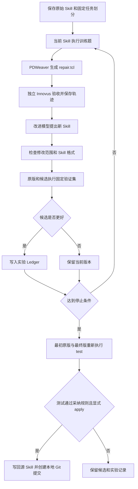

## 摘要

将 PDWeaver 接入 AgentDescent，让系统根据实际做题结果和执行轨迹，自动改进 `innovus-eco-closure-mcp/SKILL.md`。

目标按优先级排序：**先让任务通过正式验收，再在保持正确性的前提下减少耗时。** 改进模型负责提出修改，程序根据固定题目的实测结果决定是否接受。

## 背景

PDWeaver 通过 Skill 中的操作方法和检查步骤指导模型完成 EDA 任务。Skill 固定时，即使多次执行任务暴露出相同错误或重复操作，这些反馈也不会自动用于更新 Skill，仍需要人工分析和修改。

本方案引入 **RSI（递归自我改进）**：让系统根据自身执行任务的结果，持续改进指导后续执行的 Skill。PDWeaver 使用当前版本做题，改进模型结合成绩和执行轨迹提出修改；候选通过固定验证集的比较后，成为下一轮使用的版本。新版本继续产生反馈，推动下一次改进。

```text
当前 Skill 做题 → 根据结果和轨迹提出修改 → 验证候选
       ↑                                    ↓
       └──────── 使用验证后接受的新 Skill ──────┘
```

这里的递归体现在：**上一轮接受的改进，会成为下一轮执行和继续改进的起点。** 本版将改进对象限定为 `SKILL.md`，模型权重保持固定；先提高任务成功率，再减少成功任务的耗时。每次修改都经过验证，未带来改进的候选不替换当前版本。

方案复用两个项目的现有能力：


| 部分 | 承担的工作 |
| --- | --- |
| AgentDescent | 分配训练任务、生成修改提案、评估候选、管理实验版本 |
| PDWeaver | 读取 Skill、调用模型与工具、执行 Innovus 操作、生成 `repair.tcl` |
| 本目录的接入代码 | 准备工作区、正式验收、保存轨迹、选择候选和最终写回 |

## 首版范围与使用方式

本版只改进一个文件：`SKILL.md`。H0、H1、H2 表示它的不同版本，不是不同的 Agent 程序。

真实运行的来源及最终写回位置是：

```text
<PDWeaver 仓库>/skills/innovus-eco-closure-mcp/SKILL.md
```

用户提供固定的任务清单、PDWeaver 服务地址、改进模型配置和运行预算。默认运行结束交付候选及记录；显式指定 `--apply`，或之后调用 `release.py`，才执行源码写回。

三个数据集用途不同：

| 集合 | 用途 |
| --- | --- |
| train：训练集 | 用当前 Skill 做题，把结果和轨迹交给改进模型 |
| val：验证集 | 所有候选做相同的题，用于筛选和接受判断 |
| test：测试集 | 搜索结束后，重新比较最初原版与最终版；不参与反思和候选搜索 |

## 代码设计

### 1. 完整流程



### 2. 文件职责

| 文件 | 主要职责 |
| --- | --- |
| [pdweaver_skill_rsi.py](pdweaver_skill_rsi.py) | 实验入口：读取配置，启动 `evolve()`，组织最终测试与可选写回 |
| [dataset.py](dataset.py) | 读取任务划分，检查输入哈希，将题目和初始设计复制到新工作区 |
| [harness.py](harness.py) | 限制只修改 `SKILL.md`；解析提案、检查格式与大小、生成 Diff 并记录差异 |
| [experiment.py](experiment.py) | 每次创建独立试跑，安装 Skill，调用 PDWeaver 和正式验收器，返回成绩 |
| [runner.py](runner.py) | 通过 HTTP 创建会话、提交任务、等待结束、导出轨迹并清理本次 EDA 会话 |
| [verifier.py](verifier.py) | 启动新的 Innovus 进程执行可信 `verify.tcl`，验收提交的 `repair.tcl` |
| [trajectory.py](trajectory.py) | 从已保存的事件中提取有长度限制的反思材料，供改进模型阅读 |
| [selection.py](selection.py) | 比较固定验证集上的成功情况和耗时，决定选择及接受哪个候选 |
| [records.py](records.py) | 保存 Skill 全文、提案、差异、成绩、选择记录及版本关联 |
| [release.py](release.py) | 复核最终证据，写回源 Skill，创建 Git 提交与采纳回执 |

### 3. 一次试跑怎样执行

以“使用 H1 解决任务 T1”为例：

1. `TrialRunner` 生成唯一 `trial_id`，创建本次记录目录。
2. `stage_task()` 创建本次工作区，将 `task.md` 和初始设计复制进去。随后，`TrialRunner._execute()` 把 H1 的 Skill 内容写入该工作区的 `.pdweaver/skills/innovus-eco-closure-mcp/SKILL.md`。题目、初始设计和 Skill 都位于本次工作区中。
3. `run_pdweaver()` 创建新的 PDWeaver 会话并提交任务。固定任务提示要求模型通过 `skill_tool` 读取该 Skill，再解题并生成 `repair.tcl`。
4. PDWeaver 使用自身的模型配置和工具循环，通过 MCP Runtime 执行 EDA 操作。运行器等待结果，导出记录并清理属于本次工作区的 EDA 会话。
5. PDWeaver 运行结束后，`TrialRunner._execute()` 检查：工作区里的题目、初始设计和 Skill 是否保持原样；PDWeaver 是否返回 `COMPLETED`；工具调用记录是否能证明模型读取了本次工作区的 Skill。全部满足才进入正式验收，否则本次记为 0 分。这里的 `COMPLETED` 只表示 Agent 执行结束，答案是否正确由下一步验收判断。
6. `verify_submission()` 开始检查 Agent 生成的 `repair.tcl`：先将它复制到本次验收记录目录，命名为 `submission.tcl`，再启动一个新的 Innovus 进程，运行题目预先提供的验收脚本 `verify.tcl`。该脚本加载原始设计，执行这份修复脚本，再检查修复后的设计是否满足题目要求，并输出 `PASS` 或 `FAIL`。具体检查哪些指标，由该题的 `verify.tcl` 决定。
7. 保存成绩和反馈。`reward()` 读取这个成绩，不再执行一次 Innovus。

训练、验证和最终测试复用这套试跑流程。实际执行时每次使用新工作区；搜索阶段命中评估缓存时复用已有结果，不创建新试跑。

### 4. 怎样产生和选择新版本

训练试跑结束后，`trajectory.py` 整理成绩、反馈和模型/工具事件摘录。改进模型同时读取当前 Skill 和训练题，返回包含新 Skill 内容的修改提案。

假设目前使用的 Skill 是 H0，两个 worker 分别提出了新版 H1、H2。程序按下面的步骤处理。

**第一步：检查修改是否合法。** `LoggedFileTree.to_diff()` 检查模型有没有改动其他文件、新 Skill 的格式是否正确、大小是否超过 128 KiB。检查通过后，生成一份修改记录（Diff），表示“如何把 H0 改成这个新版”。这一步只检查文件，尚不能证明新版做题更好。

**第二步：把修改交给 Aggregator 统一处理。** 程序将修改记录、它基于的旧版本号、相关任务和轨迹编号打包成一张“证据卡”。可以把它理解为一份带有来源记录的修改申请。

**第三步：用验证集决定选谁、是否替换 H0。** 入口中的配置指定这两件事都使用 `selection` 的规则：

```python
Policies(
    conflict=selection,    # 从 H1、H2 等候选中选一个
    acceptance=selection,  # 判断选中的候选能否替换 H0
)
```

`selection` 是 `SuccessThenSpeed` 对象，按“先成功、再提速”的规则比较成绩。例如，选出了 H2 后，还要确认 H2 比 H0 有进步；如果 H2 与 H0 通过的题和耗时完全相同，就继续保留 H0。

接受规则是：

1. 当前版本已经通过的题，候选不能变成失败。
2. 满足上一条时，优先通过更多题的版本。
3. 通过的是同一批题时，比较这些成功题的总耗时，严格更快才算提速。
4. 全失败、耗时缺失或成绩与耗时都持平，不能靠速度获得采纳。

例如 H0 通过 T1、T2；H1 也只通过这两题但更快；H2 通过 T1、T2、T3；H3 通过 T2、T3、T4。H3 丢失了 T1 的成功结果，会被排除；H2 比 H1 多通过一道题，优先选择 H2。

每个候选都使用完整的固定验证集。当前实现依次评估候选，同一候选的多道验证题可以并行；已评估的相同内容和任务可复用缓存。接受后写入实验 Ledger，下一轮读取新版本，经验通过 Skill 内容传递。

## 评分、预算与停止条件

| 情况 | 处理方式 |
| --- | --- |
| 正式验收 PASS / FAIL | 分别记为 1 / 0 |
| 没有提交、未读取 Skill、Agent 未完成或修改了冻结输入 | 记为任务失败，得 0 分 |
| 服务异常、清理失败、验收超时或没有有效验收报告 | 记为基础设施故障，不能当作普通 0 分；阻止写回 |

Agent 正常返回的失败或运行超时，在清理等环节正常时可以成为 0 分样本；**独立验收器超时**属于结果不确定，不能据此认定 Skill 失败。

`--rounds` 控制搜索轮数；`--max-rollouts` 控制搜索执行预算，最终 test 另算。当前同步搜索在轮边界检查预算，可能超出一个轮次的执行量。基础设施故障等错误也会使搜索提前结束。

`--max-concurrency` 限制整个实验同时进行的试跑数，一次试跑包含 PDWeaver 解题及后续独立验收。用于候选速度比较的时间只覆盖 Agent 任务提交到观察到结束，包含服务端排队和轮询误差，不包含轨迹导出、清理及独立验收。

## 记录与追溯

工作区供 Agent 做题；实验记录目录保存基线、成绩和过程证据。二者使用不同目录树：

```text
<工作区根>/<run-id>/<trial-id>/
├── task.md、initial_state/       题目与初始设计
├── .pdweaver/skills/.../SKILL.md 本次使用的 Skill
└── repair.tcl                   Agent 提交的修复脚本

<实验记录目录>/
├── baseline/SKILL.md            最初原版
├── manifest.json                来源版本、任务划分和配置
├── snapshots/、diffs/           Skill 全文与修改差异
├── proposals.jsonl             改进模型的提案
├── selection.jsonl             验证集比较及采纳理由
├── trials.jsonl                所有试跑的结果索引
├── trials/<trial-id>/
│   ├── input.json、output.json  本次输入身份及结果
│   ├── agent/                  PDWeaver 导出的模型与工具事件等记录
│   ├── reflection_input.txt    发生反思时生成的轨迹摘录
│   └── verifier/               正式验收的提交副本、报告与日志
├── ledger/                     AgentDescent 实验版本及框架轨迹
├── candidate/SKILL.md           最终候选
├── final_evaluation.json        原版与最终版的 test 比较
├── evidence-manifest.json       证据文件哈希清单
└── adoption.json                写回成功后的提交回执
```

文件按实际事件产生。`agent/events.json`、`calls.json` 等记录模型可见输出、工具参数及返回结果；`reflection_input.txt` 是其中的有限摘录，包含正式成绩和反馈。当前导出不等同于每次模型请求的完整 `messages/tools` 快照，也不复制整个 `agent.db/core.db`。

## 最终测试与 Git 写回

搜索正常结束后，在未参与搜索的 test 上重新运行**最初 H0 与最终候选**。沿用“逐题不退步，成功优先，同等成功再比速度”的规则；配置 `--min-test-gain > 0` 时，还必须满足指定的通过率提升要求。

测试达到要求后，默认仍只保存结果。显式 apply 时，`release.py` 核对证据哈希、逐题成绩、候选身份和源仓库状态，再执行：

1. 将最终候选写入 PDWeaver 原生 `SKILL.md`。
2. 保存 `rsi/adoptions/<run-id>.json`，记录来源及评测依据。
3. 精确暂存相关文件并创建本地 Git 提交；原始 Skill 尚未入库或有自身修改时，先保存基线提交。
4. 将提交号写入实验目录的 `adoption.json`。中断后可根据同一实验身份核对已有提交并补记回执。

实验 `ledger/` 与 PDWeaver 源仓库是两个 Git 仓库。前者保存搜索版本；后者只在最终采纳时更新。写回不自动推送远端，也不自动更新已启动会话中的 Skill。

## 问题
### 问题1

轨迹很长，但原来的改进流程要求模型逐批读完所有材料，分析成本过高。

具体表现：

- 单次试跑的反思材料曾达到约 **28.6 MB**，包含模型输出、工具调用、Tcl、执行结果和验收记录。
- 原流程按 **24000 字符一批**串行发送，每批还重复携带任务、当前 Harness 和分析指南，因此可能产生上千次分析调用。
- 实验长时间停留在“分析轨迹”阶段，迟迟不能生成 H1；其中一次调用失败，还可能中断本次改进。
- 各批摘要最后继续汇总，既耗时，也可能遗漏关键细节。大量时间用于重复阅读材料，而不是针对问题查证。

**解决方案：完整轨迹存文件，让改进 Agent 先看索引，再按需查阅。**

```text
保留完整原始记录
    ↓
生成摘要、时间线和错误分组
    ↓
改进 Agent 搜索相关问题、分页读取完整证据
    ↓
分析原因，提出有证据支持的修改
    ↓
通过原有复测和验证集判断修改是否有效
```

具体做了四件事：

1. **适配轨迹格式**：将 PDWeaver 的 `data` 等字段转换为框架的 `TraceEvent`，关联原始事件位置。
2. **提供分析入口**：复用 `digest_traces()` 和 `drilldown()`，同时提供成功步骤、耗时、修复前后的操作和结果。
3. **保留完整正文**：避开默认加载时的 600 字符截取，支持直接读取原文件及分页副本。
4. **接入文件工具 Agent**：使用 OpenCode 搜索、读取证据并返回修改提案，记录查阅过程，设置步数和超时上限。

原来的分工是：

```text
PDWeaver Agent
    → 调用模型和 EDA 工具做题
    → 保存执行轨迹、生成 repair.tcl
    ↓
RSI 接入代码
    → 读取轨迹，按 24000 字符切片
    → 直接调用改进模型 API，逐批分析
    → 汇总分析结果，再调用模型生成修改提案
```

所以，原来的改进模型只是**收到程序准备好的文本，然后返回文本**。它没有文件工具，不能主动决定“先搜索某个报错，再读取前后几步”。

现在改为：

```text
轨迹保存在文件中
    ↓
OpenCode 改进 Agent
    → 调用模型决定查什么
    → 使用文件工具搜索、分页读取
    → 根据证据生成修改提案
```

**PDWeaver 仍负责做题，OpenCode 负责改进 Harness。**

Agent 也不能让模型的上下文无限变大；它的优势是能够**按需查资料，而不是把全部资料一次性或逐批强行塞给模型**。


# 185 服务器 PDWeaver RSI 流程与三轮实验分析

本次实验先评估原始 harness，再让三个 worker 独立解训练题、通过 OpenCode 提出修改、重跑训练题，并比较候选在验证集上的成绩。本报告记录 h0，以及第一轮 0242、第二轮 0135、第三轮 0209 的实验情况，解释修改是否加载、修正了什么、为什么仍然失败，以及验证集通过能支持什么结论。

第一轮的实际结果是：**0242 修改前 0/3 通过，修改后仍然 0/3；验证集从 h0 的 9/10，变为 w0 的 10/10、w1 的 10/10、w2 的 8/10，最终采纳 w0。修改确实进入了试跑，但单次验证结果不足以证明 harness 稳定变强。**

第二轮没有采纳更新，第三轮未进入验证集，实验最终异常退出。**截至退出时，保留的仍是第一轮 w0 的 harness；没有完成独立测试集评估。**

| 阶段 | 时间 | 训练修改前 → 修改后 | 候选验证集 | 采纳结果 |
| --- | --- | --- | --- | --- |
| h0 | 11月22日 08:44–09:44 | — | 9/10 | 原始基线 |
| 第一轮 0242 | 11月22日 09:44–15:49 | 0/3 → 0/3 | w0 10/10；w1 10/10；w2 8/10 | **采纳 w0** |
| 第二轮 0135 | 11月22日 15:49–22:14 | 2/3 → 1/3 | w0 9/10；w1 9/10；w2 未进入 | **未采纳**，验证集退步 |
| 第三轮 0209 | 11月22日 22:14–11月23日 03:50 | 3/3 → w2 FAIL、w1 INFRA_ERROR、w0 未重跑 | **没有执行** | **未采纳**，训练退步及验收异常 |

本次记录目录为 `/data2/extra500/mindrl/lyy/rsi/records/three-rounds-opencode-20261122T004122Z`。运行从 **11月22日 08:44:11** 到 **11月23日 03:50:18**，总计 **19小时06分07秒**，进程退出码为 **1**。共记录 **77 次试跑：61 PASS、15 FAIL、1 INFRA_ERROR**，包含 60 次验证集试跑和 17 次训练试跑；

## h0 原始版本的 10 道验证题

h0 于 **2026 年 11 月 22 日 08:44:15 左右开始，09:43:55 全部结束，实际等待约 59 分 40 秒**。实验进程启动时间为 08:44:11，两者相差约 4 秒。结果 **9/10，90%**。

| 题目 | Agent 解题耗时 | 含准备、清理和正式验收的总耗时 | 结果 |
| --- | --- | --- | --- |
| 0099 | 8分32秒 | 9分21秒 | **PASS**：修复 transition、capacitance 违规 |
| 0107 | 26分52秒 | 27分52秒 | **PASS**：Setup WNS 从 −131ps 改善到 +47.5ps |
| 0118 | 30分59秒 | 32分00秒 | **PASS**：Setup WNS 从 −33.9ps 改善到 +5.87ps |
| 0146 | 55分04秒 | 59分40秒 | **PASS**：Setup WNS 从 −846ps 改善到 +13ps，其他检查通过 |
| 0152 | 13分08秒 | 14分08秒 | **PASS**：时序、物理和 DRV 检查通过 |
| 0187 | 24分23秒 | 29分19秒 | **PASS**：调整缓冲器，Setup WNS 从 −36.481ps 改善到 +39.092ps |
| 0195 | 15分33秒 | 16分39秒 | **PASS**：Setup、Hold 违规均修复 |
| 0200 | 33分40秒 | 38分27秒 | **PASS**：新增缓冲器，扇出违规从 1 降至 0 |
| 0237 | 16分09秒 | 19分14秒 | **PASS**：Hold WNS 从 −9ps 改善到 +11ps |
| 0249 | 31分15秒 | 32分37秒 | **FAIL**：`FAILED_GATES:functional_types` |

## 第一轮三个 worker 使用 h0 解训练题 0242

| Worker | Agent 解题耗时 | 总耗时 | 结果 | 提交方案及直接问题 |
| --- | --- | --- | --- | --- |
| w0 | 28分22秒 | 28分36秒 | **FAIL** `FORBIDDEN_COMMAND:open` | `puts` 字符串包含 `open`，静态检查直接拒绝，尚未执行设计检查 |
| w1 | 18分08秒 | 18分57秒 | **FAIL** `CLOCK_ECO_SCOPE_GATE` | 删除两个 capture 注入时钟缓冲器；capture 保护和时钟范围检查均失败 |
| w2 | 28分40秒 | 29分29秒 | **FAIL** `FUNCTIONAL_DELTA_GATE` | 修改 capture 注入缓冲器，其中一处从 `CLKBUF_X1` 换为 `BUF_X2`，跨单元系列；capture 保护和范围检查也同时失败 |

三个 worker 都生成了 `repair.tcl`，不是未提交。

## OpenCode 对三个候选的修改对比

三次反思都交付了可解析且通过结构检查的修改提案。

| Worker | OpenCode 耗时 | 改动文件 | 主要新增要求 |
| --- | --- | --- | --- |
| w0 | 7分09秒 | 仅 `solver_prompt.md` | 提交前机械扫描禁止词；尽量交付无注释、无辅助过程的纯命令脚本；静态检查通过后再进行完整重放 |
| w1 | 7分04秒 | 新增 `innovus-clock-scope-guard/SKILL.md`，修改 `solver_prompt.md` | 区分 launch 和 capture；保护 capture 注入链；核对连接成员、范围、预算；未验证的项报告 UNKNOWN |
| w2 | 5分59秒 | 新增 `innovus-hold-clock-eco/SKILL.md`，修改 `solver_prompt.md` | 先分类路径与合法修改手段；保护注入单元；记录单元指纹；恢复 filler；提交前检查修改范围和预算 |

完整文本差异保存在 [w0 修改对比](w0-harness.diff)、[w1 修改对比](w1-harness.diff)、[w2 修改对比](w2-harness.diff)。这些文件展示 OpenCode 实际输出，不代表其中每条判断都正确。

### w0 从无静态交付检查改为先扫描文件

原提示词主要要求读取主 Skill、解题并提交 `repair.tcl`。新增的核心要求是：

```text
Scan the exact file mechanically before treating it as a candidate
Only after the scan is clean ... run one full fresh-process replay
```

w0 没有新增或修改任何 `SKILL.md`，所以准确说法是“修改了解题提示词”，不是“生成了新的主 Skill”。

### w1 从只读主 Skill 改为额外读取时钟范围 Skill

新增解题提示要求：涉及 hold 或时钟修改时，调用 `innovus-clock-scope-guard`，在修改前完成范围审查。辅助 Skill 明确要求：

```text
capture-side injected fixtures ... read-only
Compare membership and connectivity, not only timing
A cell that still exists but moved to another net or lost a sink is a scope change
```

这不只是“不要删除单元”，还要求保护连接。但它没有提供经过执行验证的分支识别与一致性检查程序；实际重跑仍由 Agent 根据自然语言要求自行判断范围。

### w2 从时序修复经验改为路径分类与提交前审查

新增提示词要求先调用 `innovus-hold-clock-eco`；辅助 Skill 要求：

```text
Never resize, move, replace, or delete an injected cell
Fingerprint them at baseline (name, master, x/y, orientation)
every changed non-filler cell is on the allowed branch
```

它修正了直接改动注入单元的思路，但列出的单元指纹没有覆盖其连接网络的全部成员。只核对单元类型、位置和朝向，仍可能漏掉间接的网络连接变化。

## 使用修改后的候选重新解 0242

| Worker | Agent 解题耗时 | 总耗时 | 正式验收结果 |
| --- | --- | --- | --- |
| w0 | 31分39秒 | 32分35秒 | **FAIL** `CLOCK_ECO_SCOPE_GATE` |
| w1 | 56分11秒 | 57分12秒 | **FAIL** `CLOCK_ECO_SCOPE_GATE` |
| w2 | 1小时59分43秒 | 2小时01分19秒 | **FAIL** `CLOCK_ECO_SCOPE_GATE` |

| 检查或指标 | w0 重跑 | w1 重跑 | w2 重跑 |
| --- | --- | --- | --- |
| Hold WNS | +36.3ps | +1.2ps | +8.7ps |
| Setup WNS | +30.281ps | +30.281ps | +30.281ps |
| 有效 SDC 与时钟定义不变 | 通过 | 通过 | 通过 |
| 功能单元改动 | 2 次同系列 resize，符合类型与预算要求 | 新增 3 个缓冲器，符合类型与预算要求 | 新增 3 个缓冲器，符合类型与预算要求 |
| `capture_injection_unchanged` | **失败** | **通过** | **失败** |
| `physical_clock_eco_scope` | **失败** | **失败** | **失败** |

### w0 修掉了静态错误 但保留了错误的修复位置

新脚本变为纯 ECO 命令，没有再因 `open` 被静态拒绝。但它仍将 `BPFE6A_0242_INJECT_1_3`、`BPFE6A_0242_INJECT_2_3` 从 `CLKBUF_X1` 改为 `CLKBUF_X3`，直接改动了受保护的 capture 注入结构，所以范围与保护检查失败。

这说明提交格式规则起了作用，未解决错误分支上的设计修改。

### w1 保护了 capture 但仍选错允许修改的位置

新方案不再删除 capture 注入链，相关检查从失败变为通过。它在 `CTS_48` 下新增时钟缓冲器，并把四个触发器的 CK 引脚重接到新网络：

```text
_49567_/CK  _50088_/CK  _50609_/CK  _49570_/CK
```

验收器第 23 行指定目标端子 `CTS_ccl_a_buf_00088/A`；第 392–395 行要求已有时钟引脚中只有该目标端子可以改变所属网络。重接上述四个 CK 引脚已足以违反这个条件。

Agent 的自检认为“只改变一条原有时钟网 CTS_48”就符合范围，但正式验收要求的是特定分支位置。**只改了一条分支，不代表选对了允许修改的位置。**

`task.md` 只描述“与这组 hold 违例相关的现有 shared launch-clock branch”，没有明确写出该目标端子；任务说明和验收规则在具体程度上存在差距。新 Skill 已要求范围检查，但 Agent 没有建立与正式验收同等精度的检查，不能仅凭其自述 PASS 当作正式通过。

### w2 修掉了跨系列替换 但改动了多条分支与受保护网络

新方案不再替换注入单元，而是在 `CTS_15`、`CTS_48`、`CTS_66` 三条分支各插入一个 `BUF_X8`，分别重接 99、100、99 个时钟接收端。功能单元类型和数量问题已避免，但这些重接仍不符合验收允许的目标位置。

此外，`BPFE6A_0242_INJECT_2_1/A` 虽仍接在原 `CTS_15` 上，**同一个网络上的其他连接成员已经改变**。验收器第 428–443 行比较注入单元的类型、位置、朝向、状态，以及各引脚所在网络的完整连接成员，不只是“这个单元还在不在”。因此 capture 保护检查依然失败。

这不是“OpenCode 一次只能修一个问题”。它一次可以修改多条规则，但本次诊断和自检没有覆盖全部限制，新的解题方案仍可能引入不同违规。

0242 验收代码还会在范围等前置检查不通过时，把 `physical_clean` 直接置为 false，跳过后续物理检查。因此，不能单凭这个 false 再认定存在一个独立的放置或 DRC 故障。

## 三个候选在 10 道验证题上的结果

由于三个训练重跑都是 FAIL→FAIL，未触发训练退步淘汰，三个候选都进入了验证。表格中的耗时是 Agent 解题耗时；每题包含准备、清理和正式验收的完整耗时另见 [验证集明细](validation-results.csv)。

| 题目 | h0 | w0 修改版 | w1 修改版 | w2 修改版 |
| --- | --- | --- | --- | --- |
| 0099 | PASS · 8分32秒 | PASS · 13分50秒 | PASS · 14分26秒 | PASS · 8分16秒 |
| 0107 | PASS · 26分52秒 | PASS · 11分06秒 | PASS · 29分24秒 | PASS · 1小时14分08秒 |
| 0118 | PASS · 30分59秒 | PASS · 27分35秒 | PASS · 41分28秒 | PASS · 40分22秒 |
| 0146 | PASS · 55分04秒 | PASS · 1小时01分49秒 | PASS · 1小时02分38秒 | PASS · 1小时07分47秒 |
| 0152 | PASS · 13分08秒 | PASS · 9分33秒 | PASS · 11分21秒 | PASS · 21分47秒 |
| 0187 | PASS · 24分23秒 | PASS · 20分29秒 | PASS · 18分38秒 | PASS · 15分12秒 |
| 0195 | PASS · 15分33秒 | PASS · 13分48秒 | PASS · 22分49秒 | PASS · 21分38秒 |
| 0200 | PASS · 33分40秒 | PASS · 20分51秒 | PASS · 36分15秒 | **FAIL** · 37分34秒 |
| 0237 | PASS · 16分09秒 | PASS · 25分43秒 | PASS · 37分01秒 | PASS · 26分22秒 |
| 0249 | **FAIL** · 31分15秒 | **PASS** · 33分14秒 | **PASS** · 59分33秒 | **FAIL** · 39分29秒 |
| **成功率** | **9/10，90%** | **10/10，100%** | **10/10，100%** | **8/10，80%** |

w2 的 0249 触发 `FORBIDDEN_COMMAND:open`，0200 为 `FINAL_GATE`。0200 输出的时序等指标看起来正常，但现有结果没有给出完整分项失败说明，不能据此猜测具体哪个检查失败。

| 验证阶段 | 开始 | 结束 | 实际等待 |
| --- | --- | --- | --- |
| h0 | 08:44:15 | 09:43:55 | 59分40秒 |
| w0 候选 | 12:20:44 | 13:27:06 | 1小时06分21秒 |
| w1 候选 | 13:27:06 | 14:31:30 | 1小时04分24秒 |
| w2 候选 | 14:31:30 | 15:48:39 | 1小时17分08秒 |

三组候选验证合计实际等待约 **3小时27分54秒**。第一轮最终于 **15:48:39** 采纳 w0，距实验进程启动约 **7小时04分28秒**，其中包含 h0、训练、反思、训练重跑和候选验证。

### 为什么 w0 被采纳

w0、w1 都是 10/10，同分比较通过题的 Agent 耗时之和：

| 候选 | 验证通过数 | 成功题 Agent 耗时之和 |
| --- | --- | --- |
| w0 | 10/10 | 3小时57分58秒 |
| w1 | 10/10 | 5小时33分33秒 |

w1 的整组实际等待时间略短于 w0，但规则比较的是并行任务的 Agent 耗时之和，所以选择 w0 并不矛盾。

### 为什么 0249 在 w0 和 w1 上通过

从交付脚本可以直接解释这三次验收结果的差别：

| 版本 | 新增单元 | `functional_types` |
| --- | --- | --- |
| h0 | 两个 `CLKBUF_X1` | 失败，0249 的新增单元类型规则不接受 CLKBUF |
| w0 | 两个 `BUF_X1` | 通过 |
| w1 | 两个 `BUF_X1` | 通过 |

但 w0 的修改针对静态禁止词，w1 的修改针对时钟修改范围；它们**都没有专门增加“0249 新增单元只能使用 BUF 或 INV”的规则**。

因此，能确认的是“这次重跑换用了合规类型，所以通过”；还不能确认“是某条新规则稳定修复了这个问题”。通用提示词可能影响了解题路线，模型重新运行也可能选择不同方案，需要重复对照才能区分影响。不能直接断言一定是巧合，也不能把 0249 的通过直接归因于新增 Skill。

## 第二轮：训练题 0135

第二轮从 **11月22日 15:48:39** 到 **22:13:41**，实际等待约 **6小时25分03秒**。三个 worker 都从第一轮采纳的 w0 版本开始。

### 修改前的训练结果

| Worker | Agent 解题耗时 | 总耗时 | 正式验收结果 |
| --- | --- | --- | --- |
| w0 | 29分49秒 | 31分57秒 | **PASS** |
| w1 | 26分13秒 | 26分26秒 | **FAIL**：`FORBIDDEN_COMMAND:backslash_newline`，提交脚本包含反斜杠续行，静态检查拒绝 |
| w2 | 15分30秒 | 17分26秒 | **PASS** |

成功的 worker 也会进入 OpenCode 反思。当前流程既允许针对失败补规则，也允许分析已通过任务中的低效步骤。

### OpenCode 实际修改了什么

以下对比的共同起点都是第一轮已采纳版；完整文本见 [第二轮 w0](round2-w0-harness.diff)、[第二轮 w1](round2-w1-harness.diff)、[第二轮 w2](round2-w2-harness.diff)。

| Worker | OpenCode 耗时 | 改动文件 | 相比上一版新增或调整的要求 |
| --- | --- | --- | --- |
| w0 | 5分18秒 | `solver_prompt.md` | 每次实验只围绕一个修改做判断；优先局部报告；减少重复全设计验证、会话创建和全数据库遍历；完整验收集中到最终重放 |
| w1 | 3分31秒 | `solver_prompt.md` | 从只扫描禁止命令词，扩展为扫描反斜杠等结构；禁止反斜杠续行，要求交付前检查实际文件内容 |
| w2 | 5分49秒 | **主 `SKILL.md` 和 `solver_prompt.md`** | 增加 post-route setup 修复路径、filler 占满时的放置处理、`dbGet` 使用经验；约束 checkpoint、分支探索与最终重放脚本的组织 |

w0、w2 主要希望减少探索与验收的重复工作；w1 针对自己的静态提交错误。这里“提出了要求”和“Agent 稳定执行了要求”需要分开判断。

### 使用修改版重新解 0135

| Worker | Agent 解题耗时 | 总耗时 | 正式验收结果 | 是否进入验证集 |
| --- | --- | --- | --- | --- |
| w0 | 42分32秒 | 46分35秒 | **PASS** | 是，PASS→PASS |
| w1 | 26分59秒 | 27分54秒 | **FAIL**：`SUBMISSION_ERROR:invalid command name "setFillerMode"` | 是，FAIL→FAIL 未触发退步淘汰 |
| w2 | 36分01秒 | 38分14秒 | **FAIL**：`FINAL_GATE`，`analysis_mode=false` | **否**，PASS→FAIL 被训练退步规则淘汰 |

- **w0 保持通过，但这次没有变快。** 总耗时由 31分57秒升到 46分35秒，不能把“提示词要求减少重复工作”直接写成已证实的效率提升。
- **w1 不再因反斜杠续行失败，但出现新的提交错误。** 脚本调用了当前验收环境无法识别的 `setFillerMode`。修改覆盖了原来的格式问题，没有保证后续命令都合法。
- **w2 修好了 setup，却没有保持分析模式。** 正式结果中 Setup WNS 从 −0.041ns 改善到 +0.004ns；时序、DRV、物理、SDC、时钟和功能检查均通过，唯独 `analysis_mode=false`。所以仍为 FAIL，并且比修改前的 PASS 退步。

这些是不同候选各一次重跑的观测结果。它们能说明哪里没有通过，不能单靠一次前后对比确定某条自然语言规则就是退步的唯一原因。

### 两个存活候选在验证集上的结果

w1 和 w0 各跑了完整的 10 题；w2 没有验证集成绩。下表均为 Agent 解题耗时，完整总耗时及试跑编号见 [第二轮验证明细](round2-validation-results.csv)。

| 题目 | 当前已采纳版（第一轮 w0 的既有成绩） | 第二轮 w0 候选 | 第二轮 w1 候选 |
| --- | --- | --- | --- |
| 0099 | PASS | PASS · 10分36秒 | PASS · 10分24秒 |
| 0107 | PASS | PASS · 1小时03分31秒 | PASS · 15分06秒 |
| 0118 | PASS | PASS · 23分53秒 | PASS · 34分33秒 |
| 0146 | PASS | PASS · 1小时45分38秒 | PASS · 3小时06分13秒 |
| 0152 | PASS | PASS · 14分43秒 | PASS · 14分04秒 |
| 0187 | PASS | PASS · 15分52秒 | **FAIL** · 19分53秒 |
| 0195 | PASS | PASS · 23分22秒 | PASS · 29分54秒 |
| 0200 | PASS | **FAIL** · 36分12秒 | PASS · 34分54秒 |
| 0237 | PASS | PASS · 20分36秒 | PASS · 21分59秒 |
| 0249 | PASS | PASS · 1小时17分23秒 | PASS · 34分28秒 |
| **成功率** | **10/10，100%** | **9/10，90%** | **9/10，90%** |

w1 的 **0187** 触发 `FORBIDDEN_COMMAND:set_analysis_view`；w0 的 **0200** 为 `FINAL_GATE`。0187、0200 在 h0 和第一轮已采纳版上都曾通过，因此这里确实观察到了逐题退步。0200 的记录未提供完整的分项 gate 结果，不据此猜测具体违规。

| 候选验证顺序 | 开始 | 结束 | 实际等待 | 通过题 Agent 耗时之和 |
| --- | --- | --- | --- | --- |
| w1 | 11月22日 17:12:31 | 20:25:01 | 3小时12分30秒 | 6小时21分35秒 |
| w0 | 11月22日 20:25:01 | 22:13:41 | 1小时48分41秒 | 5小时55分34秒 |

## 第三轮：训练题 0209

第三轮从 **11月22日 22:13:41** 到 **11月23日 03:50:18**，实际等待约 **5小时36分36秒**。第二轮未采纳更新，所以三个 worker 仍从第一轮 w0 的 `a38dafe3…` 版本开始。

### 修改前全部通过，但耗时差异很大

| Worker | Agent 解题耗时 | 总耗时 | 正式验收结果 | 结束时间 |
| --- | --- | --- | --- | --- |
| w0 | **5小时22分56秒** | **5小时28分00秒** | **PASS** | 11月23日 03:41:41 |
| w1 | 42分35秒 | 45分25秒 | **PASS** | 11月22日 22:59:07 |
| w2 | 53分24秒 | 56分18秒 | **PASS** | 11月22日 23:09:59 |

同一个 harness、同一道题，w0 的 Agent 解题时间约为 w1 的 **7.6 倍**。这直接说明，本次设置下单次耗时存在很大的运行差异，不能只看一对前后耗时就判断修改有效。

w0 的轨迹中出现 `refinePlace -eco true` 的 2400 秒超时和 `IMPSP-333` 诊断、在不兼容分析模式下报告 hold 的错误，以及多次耗时数百秒的批量 resize 探索。它最终通过验收，但这些中间问题显著拉长了训练阶段。

### OpenCode 的三份输出并非都是有效的新 Skill

| Worker | OpenCode 耗时 | 实际修改 | 是否形成有效内容修改 |
| --- | --- | --- | --- |
| w0 | 8分23秒 | `solver_prompt.md`：补充命令形式、分析模式、长步骤超时、批量操作及最终重放要求 | **有提示词修改**，尚未取得重跑结果 |
| w1 | 7分57秒 | 新增名为 `...` 的文件，内容只有 `<COMPLETE new file>`；rationale 为 `<one sentence>` | **没有有效的 Skill 或提示词修改**，格式占位文本被误接收 |
| w2 | 8分40秒 | `solver_prompt.md`：合并查询、只返回关键指标、批量修改后统一 route/extract、按实际预检查诊断修正命令 | **有提示词修改**，进入重跑 |

完整差异见 [第三轮 w0](round3-w0-harness.diff)、[第三轮 w1](round3-w1-harness.diff)、[第三轮 w2](round3-w2-harness.diff)。本轮没有候选真正修改主 `SKILL.md`。

w1 的 OpenCode 输出在上下文整理摘要处结束，没有交付真正的修改内容；输出中却包含格式示例：

```json
{"...": "<COMPLETE new file>"}
```

实际记录的 `parsed_edits` 就是这段占位内容。部署版 `reflector.py` 的 `_has_edits()` 只排除了文件名形如 `<...>` 的占位写法，**没有排除文件名 `...` 和占位正文**，因此把它判为已有修改，没有触发继续交付。后续解析和文件校验也放行了该文件。

这次 w1 的 harness 哈希虽然变化了，但 **`solver_prompt.md` 和主 Skill 与修改前完全相同**。不能把一次无效的格式产物计为“成功生成了新 Skill”，也不能把后续重新解题的差异归因于 Skill 改善。这是本轮发现的提案交付校验缺口，本文只记录问题，未修改运行代码。

### 修改后的训练重跑与未完成项

| Worker | Agent 解题耗时 | 总耗时 | 结果 | 后续处理 |
| --- | --- | --- | --- | --- |
| w0 | — | — | **没有修改后重跑记录** | 提案完成前，全局验收失败标记已触发，后续试跑被阻止 |
| w1 | 2小时23分23秒 | 2小时24分09秒 | **INFRA_ERROR**，未取得有效正式评分 | 验收同一提交共 3 次仍无完整报告，触发全局失败标记 |
| w2 | 2小时00分44秒 | 2小时03分52秒 | **FAIL**：`FINAL_GATE` | PASS→FAIL，被训练退步规则淘汰 |

**w2 修改后重跑的具体失败是 setup 没有收敛。** 正式结果中 Setup WNS 为 **−141.985ps**、Setup TNS 为 **−4929.517ps**；Hold WNS 为 +10.416ps，DRV 清零，`physical_clean=true`。因此它不是“格式问题导致没验收”，而是进入了正式设计验收，但时序目标没有全部满足。修改针对操作效率，没有保证新解题路线仍能收敛；本次 Agent 时间也从 53分24秒增加到了 2小时00分44秒。

**w1 的 INFRA_ERROR 需要结合验收日志解释。** Agent 状态为 `COMPLETED`，服务健康、清理确认均为 true。三次验收日志都明确写着：

```text
task_0209_VERIFIER_FAIL forbidden=set_analysis_view
```

但该静态拒绝路径没有产出完整的 `result.json`。外层因“没有有效的 PASS/FAIL 报告”，把它记为 `INFRA_ERROR`，并对完全相同的提交重试两次；三次提交的 SHA256 相同，三次都是上述原因。

所以这里应区分两件事：**提交本身触发禁止命令检查；验收器又没有把这个失败正常交付给外层。** 现有证据不能把它解释成模型中途断线。仅重复验收同一文件，也无法消除其中的禁止内容。

三次无有效报告后，`TrialRunner._verifier_failure` 被设置，`__call__()` 会阻止后续试跑。此时 w0 原有训练仍在执行，后来完成训练和反思，但没有取得修改后的试跑成绩；因此任务没有在 w1 出错时立即退出，而是到 **03:50:18** 才结束。

### 第三轮没有验证集和最终测试成绩

第三轮报告为 **`critic-rejected`**，原因是 `training regression: candidate failed a previously passing task (task task_0209)`，对应取得正常前后评分的 w2。w1 没有有效正式评分，w0 没有修改后重跑成绩，不能把它们写成三份均完成比较的候选。

本轮 **0 次验证集试跑**，整次实验 **0 次测试集试跑**。`failure.json` 记录了 w1 的失败试跑 `09d5a5cfb5de446ba7889d4424780058`，并标记 `experiment incomplete`；没有生成 `final_evaluation.json` 或最终 `summary.json`。

`evolution.json` 中的 `final_reward=1.0` 是保留的第一轮 w0 的既有验证成绩，**不是第三轮重新验证得到的 10/10，也不是独立测试集 100%**。三条轮次记录已经落盘，不代表整次实验正常完成。

## 修改是否真正用于试跑

第二、三轮新增的 **31 次已记录试跑**，其保存的 `solver_prompt.md` 均与各自 harness 快照一致，工作区安装的主 `SKILL.md` 也全部一致；记录中均确认读取了主 Skill。第二轮 w2 的主 Skill 修改确实安装到了重跑工作区。

因此，对于已经执行的试跑，可以确认候选文本被安装和使用；但这不能证明模型执行了文本中的每项要求，更不能代替正式验收。第三轮 w1 是特例：安装的是“增加占位文件、解题提示词不变”的 harness。第三轮 w0 没有修改后试跑，不能声称其新提示词已验证有效。

## 当前流程能证明什么

本次已经证明有效修改提案能够被解析、安装、用于重新解题，系统也会执行训练退步筛查、独立验收、验证集选择和默认采纳检查。第二轮阻止了验证集成绩下降的候选，第二、三轮也淘汰了训练题从 PASS 变成 FAIL 的候选。但第三轮同时暴露了占位文本放行和验收失败交付不完整的问题，不能说整个流程已可靠完成。

但当前证据存在四个限制：

1. **训练问题没有得到解决也可能采纳。** FAIL→FAIL 被允许继续；0242 的三个候选正是这种情况。
2. **同一道题每版本只跑一次。** h0 的 0249 失败而候选通过，不能单独区分修改效果与重新解题的随机波动。
3. **总体分数保护不等于逐题不退步。** 总体相同或提高时，仍可能有原本通过的题退步；第一轮 w2 的 0200、第二轮 w1 的 0187 和 w0 的 0200 都出现了观测退步，相关候选未被采纳。
4. **验证集反复参与选择，最终测试未完成。** 当前版还会复用既有验证成绩，并非每轮重新做同步对照。本次第三轮异常退出，没有独立测试成绩；第一轮的 10/10 不能代替最终测试结论。

如果目的是证明持续改进，需要记录并检查目标失败项是否真正修复，对当前版和候选版做多次独立对照，报告逐题退步、总体通过率及耗时变化，并在未参与选择的测试题上复核。这些是后续改进方向，不是本次已经完成的实验。

## 附件与复核入口

- [第一轮训练与反思明细](training-results.csv)：三个 worker 修改前后的训练结果、Agent 耗时、总耗时及反思耗时。
- [h0 和第一轮的 40 次验证试跑明细](validation-results.csv)：每题状态、原因、Agent 耗时、总耗时与试跑编号。
- 第一轮完整修改对比：[w0](w0-harness.diff)、[w1](w1-harness.diff)、[w2](w2-harness.diff)。
- [第一轮证据快照](evidence.json)：46 次试跑的结构化结果、六份 0242 提交、0249 提交、三个修改提案、安装比对结果，以及流程和验收代码摘录。
- [第二轮训练与反思明细](round2-training-results.csv)、[20 次验证试跑明细](round2-validation-results.csv)。
- 第二轮完整修改对比：[w0](round2-w0-harness.diff)、[w1](round2-w1-harness.diff)、[w2](round2-w2-harness.diff)，均与第一轮已采纳版比较。
- [第三轮训练与反思明细](round3-training-results.csv)：5 次实际试跑，加一行明确标记 w0 未重跑，不将其计为 FAIL。
- 第三轮完整修改对比：[w0](round3-w0-harness.diff)、[w1 占位文件](round3-w1-harness.diff)、[w2](round3-w2-harness.diff)，均与第一轮已采纳版比较。
- [第二、三轮证据快照](later-rounds-evidence.json)：新增的 31 次试跑、六份提案与 harness 快照、安装一致性核对、轮次采纳记录、w1 三次验收失败标记、运行起止时间和异常退出记录。

| 版本 | 完整 harness SHA256 |
| --- | --- |
| h0 | `0eaea096956bba57cb37cad6503816623b212e27dfa8fb747818d84d55546f7b` |
| 第一轮 w0 | `a38dafe32062d56cf2545c168a8442a535369144270d5324152ffe3d0173c8be` |
| 第一轮 w1 | `4094ed9252216940ea646189c47c6e56d6276c711870f27d5c7c2e8abb6aa72b` |
| 第一轮 w2 | `91e7c78647a8c46304eee1c6f76dd49bc6961c2845a42dac2f7e7407635c4058` |
| 第二轮 w0 | `c6bd3e36732a3eaad8876a7a5f905ad5756faca743c22f1a48466d6e27a5bc40` |
| 第二轮 w1 | `ed034c0dec8a5f1ee55ea66cbb50289f6c4cdf7c57c48137e682f7c1b81b90b6` |
| 第二轮 w2 | `a113473a76411b819c708f686d172ac9dbf5927438f17506491e6e63e4eff1fa` |
| 第三轮 w0（仅有提案） | `20fd742d745bd8c6dd2d23d3a1148d6ed10275f3583ba958c8628ad3ee583507` |
| 第三轮 w1（占位文件） | `12f133181531cf8c71ccf94a2e2cee894fac584c83e35438c06db0b54220cbd9` |
| 第三轮 w2 | `b53a2b8c0246a48b97c0cbc3e3dcdf6d29ae160031d4b56b8c2a2871b3a1ee8b` |

185 原始记录中的 `trials.jsonl` 对应试跑成绩，`changes.jsonl` 对应实际修改，`reports.jsonl` 和 `rounds.jsonl` 对应采纳结果；每题的 `verifier/result.json`、`verifier/submission.tcl`、`agent/calls.json` 可分别核对正式判定、交付文件与 Skill 调用。不要用 Agent 自述“所有检查通过”替代独立验收结果。

## 十一个采用共同预算的实测方法

下表每一行的共同设置都是：**异步，8 workers，每 seed 预算 80 次尝试，3 个 seed，总预算 240 次尝试**。这些历史结果文件通常保存了预算和每 seed 成绩，没有保存完整的实际 rollout 或合并轮次，不能据此填出一个精确的异步轮数。

| 方法 | 训练池 | 验证集 | 测试集 | worker | 每 seed 候选预算 | 独立 seed | 同步等量轮数 |
| --- | --- | --- | --- | --- | --- | --- | --- |
| PromptBreeder · GSM8K | 64题 | 64题 | 64题 | 8 | 80 | 3 | 10，实际为异步 |
| AFlow · GSM8K | 64题 | 64题 | 64题 | 8 | 80 | 3 | 10，实际为异步 |
| Self-Refine · GSM8K | 64题 | 64题 | 64题 | 8 | 80 | 3 | 10，实际为异步 |
| Reflexion · GSM-Hard | 64题 | 64题 | 64题 | 8 | 80 | 3 | 10，实际为异步 |
| SICA · GSM-Hard | 64题 | 64题 | 64题 | 8 | 80 | 3 | 10，实际为异步 |
| Gödel Agent · GSM-Hard | 64题 | 64题 | 64题 | 8 | 80 | 3 | 10，实际为异步 |
| Voyager · crafting world | 16题 | 16题 | 16题 | 8 | 80 | 3 | 10，实际为异步 |
| SkillWeaver · settings site | 16题 | 16题 | 16题 | 8 | 80 | 3 | 10，实际为异步 |
| Absolute Zero · carts | 16个生成槽位 | 16个固定任务 | 16个固定任务 | 8 | 80 | 3 | 10，实际为异步 |
| R-Zero · carts | 16个生成槽位 | 16个固定任务 | 16个固定任务 | 8 | 80 | 3 | 10，实际为异步 |
| Agent0 · carts | 16个生成槽位 | 16个固定任务 | 16个固定任务 | 8 | 80 | 3 | 10，实际为异步 |

来源：[仓库实测总表](../../../../docs/self-evolution-examples.md)，以及相应的 [PromptBreeder](../../../../bench/results/promptbreeder-gsm8k.json)、[AFlow](../../../../bench/results/aflow-gsm8k.json)、[Self-Refine](../../../../bench/results/self-refine-gsm8k.json)、[Reflexion](../../../../bench/results/reflexion-gsmhard.json)、[SICA](../../../../bench/results/sica-self-edit.json)、[Gödel Agent](../../../../bench/results/godel-agent-self-modify.json)、[Voyager](../../../../bench/results/voyager-skill-library.json)、[SkillWeaver](../../../../bench/results/skillweaver-web-apis.json)、[Absolute Zero](../../../../bench/results/absolute-zero-selfplay.json)、[R-Zero](../../../../bench/results/r-zero-challenger-solver.json)、[Agent0](../../../../bench/results/agent0-tool-curriculum.json) 原始记录。

这组方法大多不先将每份修改重新解原训练题，Voyager 和 SkillWeaver 开启了 `self_verify`。因此它们的 80 次尝试与 PDWeaver“原训练解题→反思→原题重跑”的成本不相等。自生成任务中的一个槽位还可能触发多次 solver 采样，也不是一次槽位就只调用一次模型。

以 PromptBreeder 为例，每次从头搜索使用 64/64/64 的切分，共做 3 次搜索；每次对基线和最终产物分别评估 64 道测试题，因此三次搜索的前后测试共计 **3×2×64=384 次测试作答**。seed 也会移动题目窗口，所以这不是固定同一组 64 道题每题重复三次。[切分实现](../../../_gsm8k_domain.py)、[测试前后评估实现](../../../_method_runner.py)。