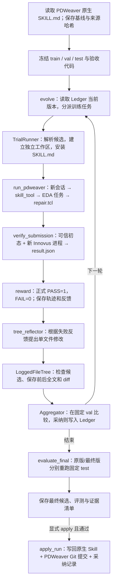

# PDWeaver：只演化一个原生 Skill 的 RSI 示例

本例将 `/home/lyy/code/eda/PDWeaver/skills/innovus-eco-closure-mcp/SKILL.md` 原样作为基线，使用 AgentDescent 的 `evolve()` 优化这一个文件。每次提案、实际修改、合并决定、任务评分和最终源码提交都保留记录。

这是 PDWeaver 的领域接入示例。旧的 `agentdescent/learning/` 文档首先演化 `PD_PROMPT`；**本例按现在的需求，演化对象改为 Skill，保留 PDWeaver 原生系统提示词、上下文组装、工具定义和引擎代码**。源码路径使用当前的 `/home/lyy/code/eda/PDWeaver`，旧文档中的双层 `PDWeaver/PDWeaver` 已不适用。

设计目标、架构、评测与采纳规则、记录和恢复机制见 [RFC：PDWeaver Skill RSI](RFC_PDWeaver_Skill_RSI.md)。RFC 单独列出后续建议，与当前已实现功能区分。

想按“哪个文件调用哪个函数”的顺序读代码，请看 [PDWeaver RSI 完整调用流程](PDWeaver_RSI完整调用流程.md)，包含启动命令、总流程图、逐步调用链和修改记录的位置。

想展开框架内部的轮次、worker 和合并过程，请看 [evolve() 内部执行流程与函数说明](evolve_内部执行流程与函数说明.md)，包含流程图、函数职责及调用 PDWeaver 的路径。

想了解 Skill 放在哪里、模型怎样发现并使用它，以及当前是否支持 `/skills`，请看 [PDWeaver Skill 内置与使用教程](PDWeaver_Skill内置与使用教程.md)。

## 先看对应文件

建议先读两个文件：

1. **`pdweaver_skill_rsi.py → run_experiment()`**：顺着看“准备 → `evolve()` → `evaluate_final()` → 保存记录 → 可选 `apply_run()`”。准备细节放在 `_load_inputs()`、`_start_run()`，改进模型的创建放在 `_build_proposer()`；`evolve()` 的参数留在主流程中，便于直接调整。
2. **`experiment.py → TrialRunner` 和 `reward()`**：`_run()` 管理一次试跑的身份、异常和记录，`_execute()` 安装 Skill、运行 PDWeaver、取得正式验收结果。成功或失败都从同一个 `finally` 保存输出；`reward()` 只读取该结果中的分数。

其余文件各负责一项接入工作，查具体实现时再读。命令行参数和记录格式保持一致，目录中没有另起一套 worker、合并器或版本管理框架。

| 文件 | 主要函数/对象 | 职责 |
|---|---|---|
| [pdweaver_skill_rsi.py](pdweaver_skill_rsi.py) | `run_experiment()` | 组装数据、执行器、改进器、Ledger；启动完整实验 |
| [harness.py](harness.py) | `load_initial()`、`LoggedFileTree.to_diff()` | 原样读取、限制只修改 `SKILL.md`、记录修改前后全文与 diff |
| [dataset.py](dataset.py) | `load_manifest()`、`stage_task()` | 固定 train/val/test；白名单复制输入并冻结文件哈希 |
| [experiment.py](experiment.py) | `TrialRunner.__call__()`、`reward()`、`evaluate_final()` | 提供 `run()` 和评分接口；组织最终配对测试 |
| [runner.py](runner.py) | `run_pdweaver()` | 新建 PDWeaver 会话、执行任务、导出轨迹、清理本次 EDA 会话 |
| [verifier.py](verifier.py) | `verify_submission()` | 启动独立 Innovus verifier，读取正式成绩 |
| [records.py](records.py) | `RunRecords` | 完整提案、修改、合并、版本号与 Git SHA 的记录 |
| [release.py](release.py) | `seal_evidence()`、`apply_run()` | 检查最终证据，显式写回 Skill、创建 Git 提交和采纳回执 |
| [tasks.example.json](tasks.example.json) | 固定任务清单 | 演示 4 train / 4 val / 2 test；真实实验前自行冻结代表性划分 |

对照仓库已有例子：`examples/evoskill/evoskill_skill_discovery.py` 展示 `run/reward/evolve` 的连接；`examples/skill_dir_evolution.py` 展示候选文件安装；本例增加 PDWeaver HTTP 执行、逐题 EDA 验收和完整修改追溯。

## 完整调用链



无须自己重写 worker、屏障、Aggregator 或 Ledger。这里的 `run` 是可调用的 `TrialRunner` 对象，传法仍是 `evolve(..., run=runner, reward=reward, ...)`。同步模式默认单 worker、串行 EDA；`batch_trigger=1, max_wait_rounds=1` 让少轮数演示也会处理候选。

`test` 只交给外层评估，不传给 `evolve()` 或改进模型。默认最终接受规则是：每道测试题都不能从通过变为失败；优先提高通过率，通过情况相同时，选择成功题总耗时更短的版本。两者都持平保留原版。`--min-test-gain > 0` 时仍强制要求通过率提升超过该值，不接受仅提速。一次配对试验不能证明随机模型的统计显著改进，正式采用应使用预先固定的多种子/重复评测方案，不能反复看 test 挑候选。

## 为什么安装到另一个目录

PDWeaver 从工程 `.pdweaver/skills/` 和用户 `~/.pdweaver/skills/` 发现技能。仓库根下的 `skills/` 是本例的来源与最终写回位置，不会因为文件放在那里就自动加载。

每次训练、验证和测试都建立新目录：

```text
<workspace-root>/<run-id>/<trial-id>/
├── task.md
├── initial_state/
│   ├── design.enc
│   └── design.enc.dat/
└── .pdweaver/skills/innovus-eco-closure-mcp/SKILL.md  ← 本次候选的精确内容
```

仅复制这三项公开输入；不复制原归档的 `metadata.json`、`reference/`、`verifier/`、预生成报告或其他任务。运行后校验输入和 Skill 没被模型修改。调用记录还要能确认 `skill_tool` 读取了本次工程技能；未读取视为本次未正确使用 Harness，不会用它证明 Skill 生效。

来源文件约 48 KB，超过框架默认单文件限制，且默认反思上下文会跳过放不下的文件。本例将文件上限、反思上下文和合并字符预算显式设为 128 KiB，并允许改进模型输出足够长的完整替换内容。候选不得删除技能、改变技能名称或新增别的可演化文件。

原文使用旧 `eda-sandbox` 的 `create_session / execute_in_session / destroy_session`。本例不预先改写原文，而在所有试跑的固定用户任务中提供 PDWeaver 的 `session_create / session_execute / session_close` 参数映射，见 `runner.py：DEFAULT_USER_PROMPT`。这段接口说明在整个实验中保持相同。

## 先运行离线演示

在已安装 AgentDescent 的 Python 环境中，从仓库根运行：

```bash
cd /home/lyy/code/eda/agentdescent/agentdescent
python -m examples.pdweaver.pdweaver_skill_rsi --dry-run
python -m examples.pdweaver.pdweaver_skill_rsi \
  --offline-demo \
  --output /tmp/pdweaver-rsi-demo
```

`--output` 必须是新目录。离线模式仍读取原始 Skill、安装独立候选、调用真实 `evolve()`、执行合并并创建实验 Ledger 提交；任务和改进器使用明确标注的确定性 fixture。它以一个演示标记验证流程，**没有调用模型、PDWeaver 或 Innovus，分数不是 EDA 成绩，禁止将离线结果 apply 到源仓库**。

`--dry-run` 仅输出计划，连 Skill 和数据集都不读取，适合先检查参数与路径。

## 真实运行前的准备

1. 准备独立、配置固定的 PDWeaver Agent + Runtime 服务，使用当前选定的源码版本。按 PDWeaver 自身的安装与配置说明配置模型和商业工具，设置有限的 `agent.max_iterations`、`agent.run_timeout_s`；凭据使用环境变量，不写入实验配置。推理模型通过 PDWeaver 配置选择，改进模型通过本例的 `--reflect-model` 选择，两者可以不同。
2. 固定该服务的用户级技能、模型参数、上下文配置、PDK、工具版本与许可证环境。实验期间不热更新或复用它做无关任务。本例比较公开服务指纹，能检测服务重启及公开模型/预算变化；API 没有暴露的配置仍需要由部署环境固定。
3. 展开数据集的 Git LFS 资产，检查目标任务确实使用 `verifier/verify.tcl`、`SUBMISSION_TCL`、`OUTPUT_DIR` 和 `result.json.status` 协议。本例明确只支持这个协议；遇到 `verify.py` 要另写对应适配，不会猜测调用方式。
4. 先冻结任务清单，之后再运行。清单中的相对路径以 JSON 所在目录为基准。示例清单只是接线示范，未声称做过 repair family 分组或形成正式 Benchmark；正式试验应避免同源近重复题跨集合。
5. 将公开试跑目录与私有数据归档、实验记录隔离。当前 HTTP runner 接受本机 loopback 地址，要求 PDWeaver 与适配器看到相同绝对工作区路径。可以通过隔离容器/虚拟机和固定路径挂载公开目录实现；**本例的文件白名单不是操作系统沙箱**。若直接在同一用户下运行，它只是可信开发模式，不能声称模型无法访问宿主机的私有验收资产。

本例会冻结题面、checkpoint 和题目 `verifier/` 目录的文件清单与哈希，在每次试跑和验收时检查漂移。verifier 目录以外的库、PDK、工具二进制和站点配置仍由部署方固定。

PDWeaver 源码要求先固定版本；允许目标 Skill 本身为新文件或有未提交修改，其他已跟踪改动和未跟踪文件需先处理。每次试跑前后还会核对源码 HEAD、工作区状态和原始 Skill 哈希，避免实验途中更换基线。

例如，在已有完整 Agent 配置的前提下启动专用服务：

```bash
/home/lyy/code/eda/PDWeaver/.venv/bin/pdweaver \
  --config /absolute/path/to/rsi-agent.yaml serve
```

Agent 和 Runtime 使用各自已配置的端口。下面的 `8766` 只是示例，应换成 Agent 实际端口；运行器从 Agent `/api/ui` 取得 Runtime 地址。被改进模型的密钥由 PDWeaver 读取；改进器默认读取 `OPENAI_API_KEY`、`OPENAI_BASE_URL`，可通过 `--api-key-env`、`--base-url-env` 改环境变量名。

```bash
python -m examples.pdweaver.pdweaver_skill_rsi \
  --pdweaver-repo /home/lyy/code/eda/PDWeaver \
  --manifest examples/pdweaver/tasks.example.json \
  --server http://127.0.0.1:8766 \
  --workspace-root /data/pdweaver-rsi-public \
  --output /data/pdweaver-rsi-private/run-001 \
  --reflect-model YOUR_MODEL_ID \
  --rounds 2 --workers 1 --max-concurrency 1 \
  --trial-timeout 1800 --verifier-timeout 600
```

真实模式会使用模型额度和 EDA 许可证。`rounds` 是搜索轮数，不是全数据集遍历数；训练、验证的实际运行次数还受合并和缓存影响，最终配对测试另算。`--max-rollouts` 是引擎搜索预算，不包含最后的基线/候选 test 重跑；`--reflect-max-tokens` 只限制改进模型的单次输出。

框架的 `Usage` 只直接统计改进模型调用；PDWeaver 内部模型调用与工具成本应从其 runs/events 记录汇总，不能把框架 token 数当成整个 EDA 实验的总费用。

## run、reward 和异常各自做什么

`TrialRunner` 解析 `FileTree` 的完整序列化值，安装 `state["SKILL.md"]`，调用 `run_pdweaver()`。后者通过 HTTP 新建 Agent session 和 task，轮询任务，导出完整 calls/runs/messages/events。`WAITING_USER` 不视为成功；超时会停止推理，并关闭经工作区核对属于本次试跑的 EDA 会话，等待 `CLOSED`。无法确认资源已释放会使实验失败。对于 PDWeaver 将 Runtime ID 脱敏为别名的情况，本例保守报告清理故障，不猜测真实身份。

任务完成且读取过技能后，验收器将 `repair.tcl` 固化到私有证据目录，在新的 Innovus 进程里加载可信初态并验收。即使进程退出码为 0，也必须看 `result.json.status`：`PASS → 1.0`，`FAIL → 0.0`。缺少提交为 0。旧协议中的 `EXECUTION_ERROR` 可能来自提交 Tcl 错误，也可能来自环境/加载失败，无法可靠区分时记为 `score=None`，终止本次实验的采纳资格。

`reward(task, output)` 只解析适配器返回的可信 JSON，不再运行一次 Innovus，也不相信 Agent 自述的 PASS。服务不可用、验收超时、缺失报告、资产漂移等不会伪装成普通零分：保存故障、标记实验不完整、阻止最终写回。

反思模型实际收到当前 Skill、训练题面、正式评分/指标，以及 `trajectory.reflection_input()` 从本次 `agent/events.json` 提取的模型输出、工具参数和结果的时间线。成功时要求保留正确性、减少重复步骤；失败时先修正错误。每步最多保留约 1600 字符，时间线保留首尾共约 16000 字符，整体输入上限 24000 字符；实际使用的反馈保存为 `reflection_input.txt`。完整导出文件不裁剪，私有验收原始日志不进入反思模型。

## 成功后怎样选择更快的 Skill

`selection.SuccessThenSpeed` 通过框架的 `Policies(conflict=..., acceptance=...)` 接入 Aggregator，无需修改引擎。每个候选在相同的完整 `val` 上运行；已评估的相同 Skill/任务会复用缓存。

1. 正式成绩保持 `PASS=1、FAIL=0`，不把速度混入 Reward。
2. 不允许已通过的验证题退步，先选通过题数更多的候选。
3. 通过情况相同时，选成功题 `agent_elapsed_seconds` 总和更小的候选。通过数量相同但通过的题不同，不用耗时打破平局。全失败、缺少有效计时或耗时持平都不能靠速度获得采纳。
4. `solved_threshold=1.1` 让得 1 分的训练题也进入反思，继续提出提速修改。停止条件仍由轮数和预算决定。
5. 固定 test 重跑以及最终 `apply_run()` 复核使用同一规则，写回前会从已封存的逐题记录重新计算。

例如三个候选都通过 4 道验证题，成功题总耗时分别为 7200、5400、6000 秒，就选择 5400 秒的候选。若它只通过 3 道，而另一个通过 4 道，就优先后者。不同 worker 的训练题耗时不能直接横向比较。

耗时从提交 Agent 任务开始，到观察到任务结束为止，包含服务端排队和轮询误差，不包含本地并发锁等待、轨迹导出、资源清理或独立验收。比较记录在 `selection.jsonl`，含 worker、Skill 哈希、逐题轨迹编号、通过情况、耗时和选择结果。排序按实测数值执行；大模型利用轨迹提出改进，不负责猜测哪个更快。

轨迹来自 PDWeaver 已有的公开导出：`events.json`、`calls.json`、`task.json`、`runs.json`、`session.json` 和 `runner.json`。不复制整个 `agent.db/core.db`，也不把这些文件冒充每次模型请求的完整 `messages/tools` 快照。离线演示使用固定模拟耗时，不产生真实 PDWeaver 模型轨迹。

## 每次改了什么，在哪里看

```text
<output>/
├── manifest.json             来源文件/代码版本、任务划分、配置与冻结资产哈希
├── baseline/SKILL.md         原始全文，字节保持一致
├── proposals.jsonl           原始提案、训练题、评分、反馈、无提案/异常
├── changes.jsonl             每次 to_diff 的修改、理由、基线版本、结构校验结果
├── snapshots/<sha256>.md     每个修改前后版本的全文
├── diffs/<sha256>.patch      可阅读的逐行差异
├── reports.jsonl             Aggregator 的完整采纳/拒绝报告和实际候选
├── accepted.jsonl            已采纳修改的 diff_id、版本与 Ledger commit
├── rounds.jsonl              每轮指标
├── ledger/                  AgentDescent 自己的实验 Git 仓库与 trajectories/
├── ledger_history.json       逐版本映射到实际 Git SHA，含完整修改
├── trials.jsonl              每个试跑的候选哈希、任务、阶段、评分与证据位置
├── successful_trials.jsonl   所有正式得 1 分的试跑，关联 Skill 快照、耗时与 agent/ 轨迹
├── selection.jsonl           固定验证集上的候选排序与采纳依据
├── trials/<trial-id>/
│   ├── input.json / output.json / public_inputs.json
│   ├── agent/               session、task、calls、runs、events、服务指纹
│   ├── reflection_input.txt  本次训练反思实际使用的反馈与轨迹摘录（发生反思时）
│   └── verifier/            submission.tcl、result.json、Innovus 日志/报告
├── evolution.json            框架最终结果
├── candidate/SKILL.md        搜索结束时的最终候选
├── final_evaluation.json     固定 test 上原版/新版的逐题配对结果
├── evidence-manifest.json    持久证据文件的 SHA256 清单
└── adoption.json             显式写回成功后的 PDWeaver commit 与采纳回执
```

文件按事件产生：没有提案/没有采纳时，不会凭空生成对应事件记录。失败试验另有 `failure.json`。`changes.jsonl` 中 `accepted-for-evaluation` 仅表示结构检查通过；是否真正采纳要看 `reports.jsonl`、`accepted.jsonl`。Ledger 保存采纳后的状态，完整的拒绝提案靠旁边的记录保存，不能只看 Git 历史。

记录写入失败会阻止成功结论和最终应用。证据保存在 Ledger 目录外，避免 Ledger 的内部提交把任务日志与隐私资产一起纳入候选版本库。

## 显式写回、Git 提交与恢复

默认实验结束只交付记录和候选文件。通过真实外层测试后，可对已有实验执行：

```bash
python -m examples.pdweaver.release --run /data/pdweaver-rsi-private/run-001
```

也可在真实运行命令中加 `--apply`，在评估通过后直接执行相同流程。应用前检查证据哈希、候选与试跑身份、测试结果、来源源码版本和源 Skill 是否漂移；存在用户已暂存的修改时会报错，避免混入提交。

本例使用精确路径暂存和提交，创建本地 PDWeaver Git commit，并写入 `rsi/adoptions/<run-id>.json`。若原生 Skill 尚未跟踪或自身有未提交改动，会先单独提交**已评测的原始 Skill 基线**，再提交采纳版本，保证 revert 有完整原版可恢复。当前提供的 Skill 正是新加入、尚未跟踪的文件，这种情况已纳入流程。其他源码若发生变化，需要重新固定基线并评测。

采纳提交中记录来源版本、候选哈希、成绩、Ledger 提交、外部证据目录及清单哈希；提交成功后，将新 commit SHA 写入外部 `adoption.json`，避免“把提交自己的 SHA 写进自身”的循环。提交已成功但外部回执缺失时，可用同一命令按 `run_id` 查回已有提交并补记。

这里记录的是 `committed`，没有自动推送远端，也不将它冒充运行实例已加载。下一次试跑会从源 Skill 重新提取并安装；日常 PDWeaver 工程使用该技能时，仍要安装到该工程 `.pdweaver/skills/` 并启动新会话确认读取。

需要撤销时，对 `adoption.json` 中的采纳 commit 执行 `git revert <commit>`，保留回退提交与原因，并重新安装原版技能。不要删除实验日志；任务工作区/EDA 状态也不会随源码 revert 自动恢复。

## 验证与限制

离线测试覆盖目录隔离、冻结输入、候选安装、HTTP 会话和资源清理、正式验收协议、完整修改日志、真实 Ledger 提交、最终接受规则及临时 Git 仓库中的采纳/回退条件：

```bash
python -m pytest -q tests/test_pdweaver_*.py examples/pdweaver/test_selection.py
```

本次开发使用离线 fixture 和 HTTP/进程替身验证流程；未消耗真实模型或 Innovus 资源。实际 EDA 效果需要在数据资产、站点工具与隔离环境准备好后测量。原始 Skill 的协议兼容性、每道 verifier 的保证范围和实验划分质量，都不能由离线测试替代。

参考材料：`agentdescent/learning/AgentDescent_原生Harness_RSI完整流程与函数调用链.md`、`agentdescent/learning/设计方案.md`、`PDWeaver_learning/learning/Agent搭建与EDA任务流程.md`、当前 PDWeaver `core.py` 的技能发现及 `api.py/store.py` 的会话与轨迹接口。
